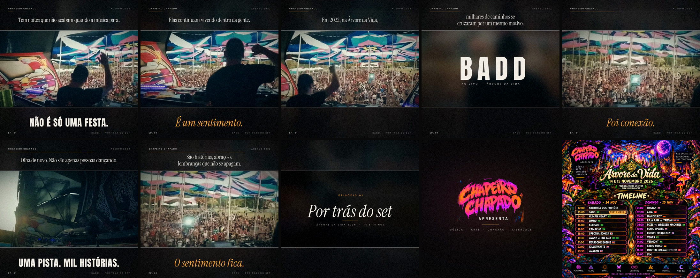

# Série "Por trás do set" — Chapeiro Chapado · Árvore da Vida 2026

Um vídeo por dia, reeditando o acervo de 2022 para divulgar a edição **Árvore da Vida 2026
(14 e 15 de novembro, Fazenda Bons Ventos, Pirassununga/SP)**. Todos os episódios saem do
mesmo motor e da mesma marca, então o padrão é garantido pelo código, não pela memória.

| Ep. | Artista | Pasta | Status |
|-----|---------|-------|--------|
| 01 | BADD | `episodios/ep01-badd` | ✅ entregue |

## Estrutura

```
serie/
  marca/            identidade FIXA (não muda entre episódios)
    marca.json      textos da série, cores, durações, mapa da line-up
    fonts/          Instrument Serif (narração/emoção), Anton (impacto/título)
    lineup_2026.png pôster oficial da line-up (fonte do logo e do fechamento)
  motor/
    analisar.py     raio-x de um vídeo novo (recorte, títulos queimados, drop, folhas de contato)
    render.py       gera o episódio a partir de episodios/<ep>/episodio.json
  episodios/
    ep01-badd/      episodio.json (roteiro), original.mp4, EP01_BADD_1080.mp4 (entrega)
```

## Padrão visual (o que NÃO muda)



**Formato:** 1080x1080, 25 fps, H.264, AAC 256k a -14 LUFS / -1 dBTP. Entrega < 100 MB.

**Layout:**
- Faixa de imagem 16:9 fixa de 1080x600, em y=240, com filetes brancos finos em cima e embaixo.
- Fundo quase preto `#09090A` com luz ambiente tirada das cores da cena, vinheta e grão de filme.
- Cabeçalho: `CHAPEIRO CHAPADO` à esquerda, `ACERVO <ano>` à direita, e uma barra de progresso âmbar fina embaixo.
- Rodapé: `EP. NN` à esquerda, `<ARTISTA> · POR TRÁS DO SET` à direita.

**Tipografia (sempre uma dessas quatro vozes):**
| Voz | Onde | Fonte | Uso |
|-----|------|-------|-----|
| Narração | topo, acima da faixa | Instrument Serif 46px, frase normal | a história, frase a frase, entrando palavra por palavra |
| Impacto | embaixo da faixa | Anton 74px, CAIXA ALTA | afirmações curtas ("NÃO É SÓ UMA FESTA.") |
| Emoção | embaixo da faixa | Instrument Serif Itálico 84px, âmbar `#F2A640` com brilho | a virada emocional ("É um sentimento.") |
| Selo | embaixo da faixa | Inter 19px espaçada, com filetes âmbar | local e ano ("ÁRVORE DA VIDA · 2022") |

**Cor:** branco quente `#F4F0E8`, âmbar `#F2A640`. O âmbar é só para emoção e detalhes, nunca para texto corrido.

**Estrutura de todo episódio:**
1. Narração e frases sincronizadas com a música do acervo.
2. **Nome do artista**: Anton 210px sobre a imagem desfocada, com o espaçamento entre letras fechando devagar e "AO VIVO · ÁRVORE DA VIDA" embaixo.
3. **Cartela final**: "EPISÓDIO NN / *Por trás do set* / ÁRVORE DA VIDA 2026 · 14 E 15 NOV" sobre a imagem desfocada.
4. **Corte seco para a marca** (1,4 s): logo Chapeiro Chapado + "MÚSICA · ARTE · CONEXÃO · LIBERDADE". Entra junto com o drop da própria trilha.
5. **Line-up** (5 s): pôster oficial com a linha do artista acesa e o selo "NESTE VÍDEO".

**Regra do ano:** as imagens são de 2022, então a narração e o "ACERVO 2022" falam de 2022. Só o
fechamento (cartela, marca e line-up) fala de 2026.

## Como fazer o próximo episódio

1. Crie a pasta e coloque o vídeo:
   `episodios/ep02-<artista>/original.mp4`
2. Rode o raio-x:
   `python3 motor/analisar.py episodios/ep02-<artista>`
   Ele mostra o recorte da faixa, as janelas de título queimado, o volume e as folhas de contato com as legendas antigas.
3. Copie `episodios/ep01-badd/episodio.json` para a nova pasta e preencha:
   - `numero`, `artista`, `saida` (`EPNN_<ARTISTA>_1080.mp4`), `acervo`;
   - `recorte`: use o sugerido;
   - `narracao` e `frases`: transcreva as legendas antigas (frase normal na narração), mantendo os tempos do original;
   - `titulo`: a janela do nome queimado **com ~0,4 s de folga de cada lado** (os fades enganam a detecção);
   - `cartela_inicio`: ~0,15 s antes do texto final queimado aparecer; `corte_marca`: perto do fim da trilha, num tempo forte;
   - `drop`: o ataque do drop (refine em passos de 0,05 s);
   - `lineup` (opcional): o nome exato no mapa de `marca.json`, se for diferente do `artista` (ex.: "AVAN7 VS INE GOA").
4. Teste quadros soltos antes de renderizar tudo:
   `python3 motor/render.py episodios/ep02-<artista> --frames 2,15,30,45,56,58,61`
   Confira principalmente se **nenhum texto antigo aparece** perto das janelas do título e da cartela.
5. Render completo (~5 min): `python3 motor/render.py episodios/ep02-<artista>`
6. Atualize a tabela de episódios acima e faça o commit (o `*_master.mp4` fica fora do git).

Requisitos: ffmpeg, Python 3, Pillow e NumPy. A fonte Inter é do sistema (`/usr/share/fonts/opentype/inter`).

## Lições do EP01 (não repetir)
- A detecção automática de título queimado erra os fades: o "BADD" foi detectado de 14,28 a 17,68 s, mas aparecia de ~13,8 a ~18,2 s. Sempre confira olhando os quadros em passos de 0,1 s.
- O pôster é a fonte do logo. Ele é recortado pelo brilho, porque o fundo é quase preto. Se o pôster mudar, ajuste `logo_recorte`.
- O grão de filme pesa na compressão: o master sai com ~200 MB. Por isso a entrega usa CRF 21 / 10 Mbps (~80 MB).
- O salto do final calmo para o drop é grande, por isso o drop entra 4 dB abaixo.
